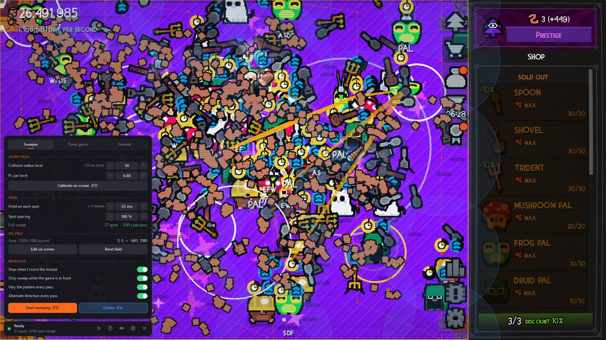

# Dirt Sweeper

An auto-sweeper and timer-minigame helper for the Steam game **Dirt Clicker**: a free, small, open-source overlay for Windows.

Dirt Sweeper moves your cursor over the whole dig field so every tool gets hovered without you doing it, and plays the red-button timer minigame by itself. Everything is controlled from a compact HUD bar on top of the game, including all of its settings, so you never have to alt-tab.

Website: https://eyyminda.github.io/Dirt-Sweeper/. Unofficial fan-made tool, not affiliated with the developers of Dirt Clicker.

Current version: **0.1.1**. See [CHANGELOG.md](CHANGELOG.md) for what's new.

## Download

Get `DirtSweeper-<version>.exe` from [Releases](https://github.com/eyyMinda/Dirt-Sweeper/releases/latest) or the [website](https://eyyminda.github.io/Dirt-Sweeper/). It's a single exe of about 100 KB with no installer.

Requirements:

- Windows 10 or 11. Nothing to install: it uses the .NET Framework 4.8 that's built into Windows.
- Dirt Clicker from Steam. The app finds the game window by itself and adapts to its resolution and aspect ratio.
- The exe isn't code-signed, so SmartScreen may warn the first time: choose **More info**, then **Run anyway**. You can verify the download against `SHA256SUMS.txt` in the release.

The app collects no data; see [Privacy](#privacy).

## Features

- **Sweeps the whole dig field:** the cursor rests briefly on a set of spots chosen so the hover circles cover the entire field with no gaps, using as few spots as possible. At collision radius 56 on 1920×1080 that's 28 spots, less than half a second per pass.
- **Follows your upgrades:** the hover circle size comes from your **collision radius** level. Calibrate once, then press **+** when you buy an upgrade.
- **Plays the timer minigame:** watches the timer, catches the moment each countdown starts and clicks the red button exactly on time, level after level. Flying dirt particles are ignored.
- **All settings in the overlay:** the gear on the HUD unfolds the settings right over the game. It never takes focus from the game, so you see every change immediately.
- **Calibrate with the mouse wheel:** press F7 and scroll until the green ring matches the game's hover circle.
- **Drag the dig field into place** directly over the game, and see the field, the sweep spots and the timer box with the guides (F6).
- **Stays out of your way:** only sweeps while the game is in front, stops as soon as you move the mouse, and hides when you switch to another app. The mouse passes through the HUD while the app is moving the cursor.
- **Light on your PC:** almost no CPU when idle; while working it only moves the mouse and looks at a small part of the screen.
- **Updates in one click:** it tells you when a new version is out (a dot on the gear and a notification), and **Update** in the About tab installs it and restarts.

## How to use it

1. Start Dirt Clicker and `DirtSweeper.exe` (the HUD has a button to launch the game if it isn't running).
2. Click the gear on the HUD, set **Collision radius level** to your upgrade level.
3. Press **F7**, move over the dig field and scroll until the green ring matches the game's hover circle. Press **F7** again.
4. Press **F5** to sweep. Move the mouse to stop it.
5. For the timer minigame, press **F8**, then click **Play** in the game. Every level is played automatically, and sweeping resumes afterwards.

| Key | Action |
| --- | --- |
| F5 | Start / stop sweeping |
| F6 | Show / hide guides |
| F7 | Calibration ring at the cursor (scroll to resize; Shift = fine, Ctrl = coarse) |
| F8 | Arm / cancel the timer game (then click Play) |
| F9 | Show / hide the HUD |

## Settings

Everything is in the settings panel (gear on the HUD, or double-click the tray icon). Hovering an item explains it in the bar. Values change with **−** / **+** (hold to repeat) or by scrolling over the row; hold Shift for bigger steps.

- **Sweeper:** collision radius level and px per level (calibration), hold time on each spot, spot spacing, the dig field, and whether to stop when you move the mouse, only sweep while the game is in front, vary the pattern and alternate direction every pass.
- **Timer game:** which levels to play, click offset (if the game says you were late by X ms, lower it by X), resume sweeping afterwards, timer and button positions (pick them by hovering), and detection fine-tuning.
- **General:** game status, guides, HUD, hotkeys, reset, open the settings folder.
- **About:** version, check for updates (automatic checks can be turned off), report a bug or request a feature, links.

Tips:

- If some tools get missed, raise **Hold on each spot**. If everything gets hit, you can try lowering it for faster passes.
- The defaults are tuned for 1920×1080 fullscreen at 144 FPS. Other resolutions and wider screens are scaled automatically.

Settings are saved automatically to `%LOCALAPPDATA%\DirtSweeper\settings.json` (General → **Open settings folder** shows it). Versions before 0.1.1 kept them next to the exe; they're moved over on the first start.

## Questions

**Is it safe to use?** Dirt Sweeper never touches the game: it doesn't read or change game files or memory and doesn't inject anything. It only moves the mouse and looks at the timer area of the screen, like a person watching and clicking. Use it at your own discretion.

**Does it work when the game isn't in front?** By default it only sweeps while Dirt Clicker is the active window, so it never moves the mouse while you're doing something else (you can turn that off in the Sweeper tab).

**It clicks the timer too early or too late.** Adjust **Click offset** in the Timer game tab by the number of milliseconds the game reports.

**How do I remove it completely?** Close it (✕ on the HUD or Exit in the tray menu), delete the exe, and delete the folder `%LOCALAPPDATA%\DirtSweeper` (paste that into the Explorer address bar, or use General → **Open settings folder**). That's everything: it installs nothing else, adds no startup entries and doesn't touch the registry or the game.

## Privacy

Dirt Sweeper collects no data and has no accounts, analytics or telemetry. The only time it goes online is to ask GitHub for the latest release (at startup and once a day, which you can turn off in About) and to download an update when you click **Update**. These requests send nothing about you beyond what any connection does (your IP address and the app's version). Your settings stay on your PC in `%LOCALAPPDATA%\DirtSweeper`.

## Feedback

Found a bug, or have an idea for a feature? [Open an issue](https://github.com/eyyMinda/Dirt-Sweeper/issues/new/choose); every report helps. The About tab in the app has a button for it too.

## Credits

Made by [eyyMinda](https://github.com/eyyMinda). If Dirt Sweeper saves you some clicking, you can [buy me a coffee](https://buymeacoffee.com/eyyminda). Dirt Clicker belongs to its developers; this is an unofficial fan-made tool.

## License

[GNU General Public License v3.0](LICENSE). Not affiliated with or endorsed by the developers of Dirt Clicker.
